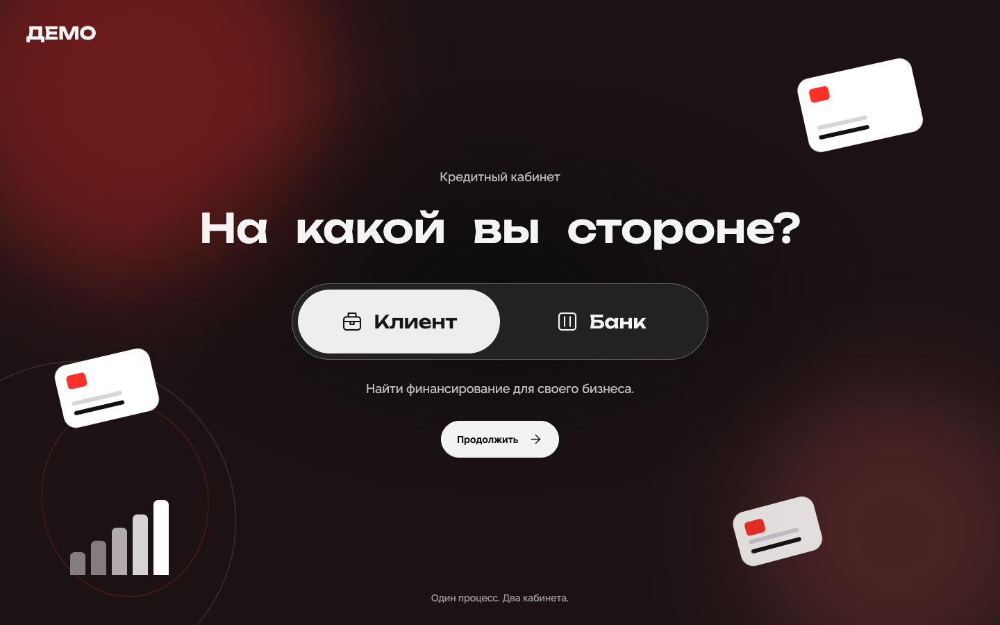
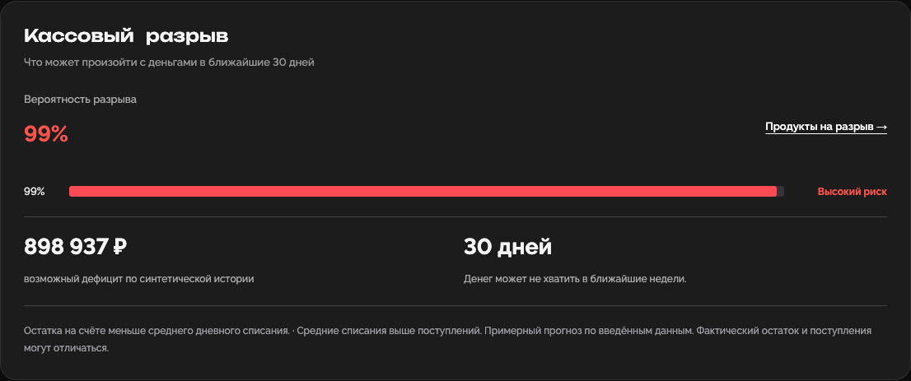
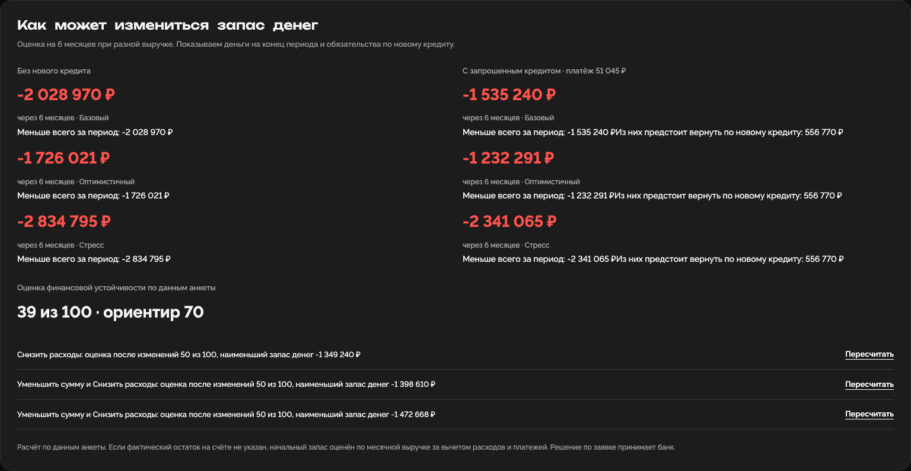
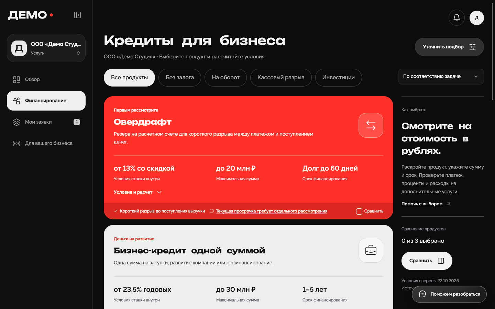
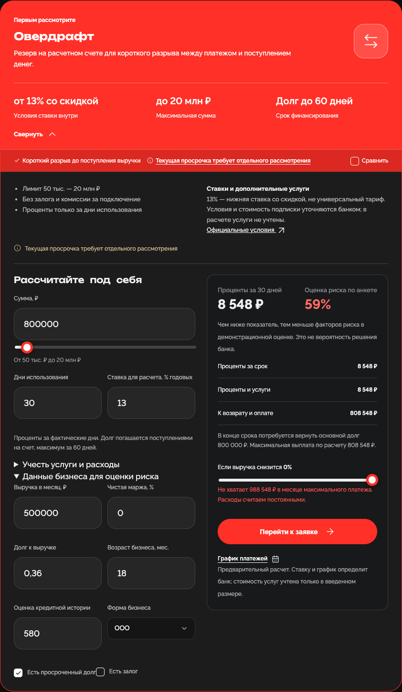
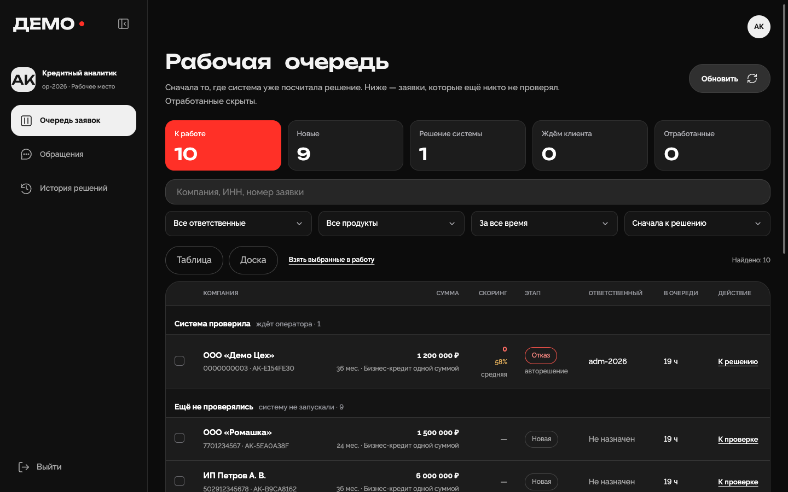
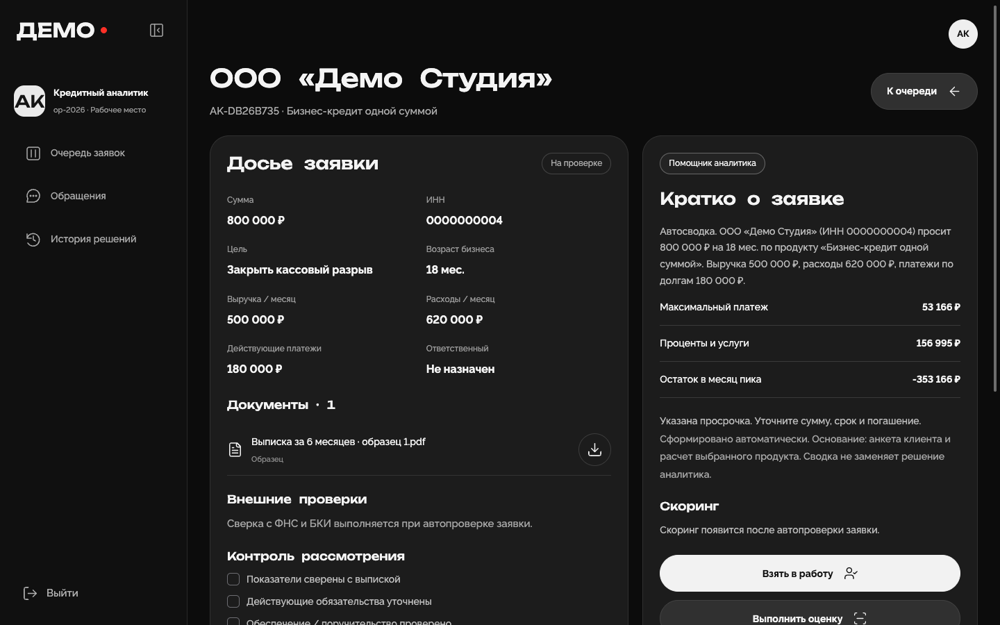
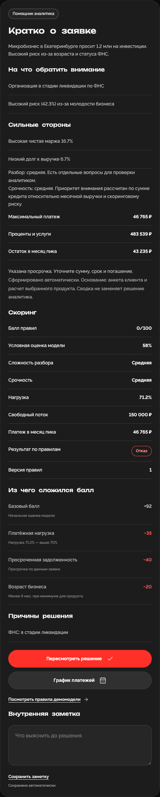
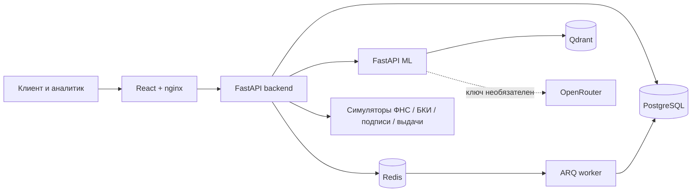

# Альфа Пульс · умный кредитный кабинет

**Один путь от потребности бизнеса до объяснимого решения банка.** Предприниматель видит финансы, сравнивает продукты и подаёт заявку. Аналитик получает досье, результаты проверок, факторы риска и инструменты для решения. Проект создан для АльфаХак 2026; учётные записи, заявки и финансовые показатели в демо синтетические.



**[Запуск](#запуск-за-3-команды) · [Сценарий для жюри](#сквозной-сценарий-для-жюри) · [Демо экранов](#интерактивное-демо) · [Архитектура и материалы](#архитектура-и-материалы)**

## Запуск за 3 команды

Нужны Docker с Compose v2, свободное место для образов и интернет при первой сборке: ML-образ загружает энкодер поиска. На ARM-компьютере ML запускается через эмуляцию `linux/amd64`, поэтому первая сборка может быть долгой. Ключ OpenRouter для генеративных функций уже есть в `.env.example`.

```bash
git clone https://github.com/Soln1shko/alfa-smart-credit-cabinet.git
cd alfa-smart-credit-cabinet
cp .env.example .env && docker compose up -d --build --wait
```

Откройте **http://localhost:8080**. Если порт занят, задайте `WEB_PORT` в `.env` по образцу [.env.example](.env.example). Проверка стека: `docker compose ps`, [готовность API](http://localhost:8080/api/v1/health/ready), [Swagger](http://localhost:8080/api/v1/docs). Остановка: `docker compose down` (данные в томах сохраняются).

При первом запуске Alembic создаёт схему, сидер добавляет демонстрационные организации и заявки. Ничего отдельно импортировать не требуется. OCR при первом распознавании может дополнительно загрузить модель.

| Роль | Вход | Пароль |
| --- | --- | --- |
| Клиент с пятью готовыми примерами | На `/login` нажмите «Вход», затем «Магазин», «Сезонный бизнес», «Новый цех», «Студия» или «Фабрика» | Подставится автоматически |
| Клиент для новой заявки | `client@demo.ru` | `Demo2026!` |
| Клиент для онбординга | `new@demo.ru` | `Demo2026!` |
| Аналитик банка | `/bank/login`, ID `OP-2026` | `Alfa2026!` |
| Администратор банка | `/bank/login`, ID `ADM-2026` | `Alfa2026!` |

## Сквозной сценарий для жюри

1. На главной выберите **«Клиент» → «Продолжить» → «Вход» → «Студия» → «Войти»**. В «Обзоре» найдите кассовый разрыв, прогноз денег на шесть месяцев и действия, которые меняют оценку финансовой устойчивости.
2. Откройте **«Финансирование»**. Каталог поставит овердрафт первым с причиной соответствия. Раскройте продукт: поменяйте сумму или выручку и посмотрите расчёт, нагрузку и график. Для обычной заявки выберите «Бизнес-кредит одной суммой» → «Перейти к заявке».
3. Пройдите форму **«Параметры → О компании → Документы → Проверка»**. В документах можно добавить встроенный синтетический образец. Отправьте заявку. Сохранённый черновик позволяет вернуться к заполнению.
4. В другом профиле браузера войдите как `OP-2026`. В **«Очереди заявок»** найдите заявку по компании или номеру, откройте досье, возьмите её в работу и нажмите **«Выполнить оценку»**. Этапы проверки обновляются в интерфейсе; ФНС и БКИ здесь локальные симуляторы.
5. Сравните **балл и факторы скоринга** с **результатом продуктовых правил**. Посмотрите историю заявки и, при необходимости, запросите сведения или пересмотрите решение. Вернитесь в клиентский кабинет: там появятся статус и причины; при одобрении доступны демонстрационные подпись и выдача.

Для быстрого просмотра разных исходов внизу банковской очереди есть кнопки **«Одобрение»**, **«Другие условия»**, **«Ручной анализ»**, **«Отказ»**. Они создают отдельные синтетические заявки. Подпись и перечисление денег имитируются; реальные банковские операции не выполняются.

## Интерактивное демо

Раскройте блоки, чтобы увидеть реальные экраны локально запущенного Docker-стека. Снимки сделаны на демонстрационных данных; каждую возможность можно повторить по шагам выше.

<details open>
<summary><strong>★ Киллер-фича 1. Бизнес видит риск кассового разрыва и проверяет «что если»</strong></summary>

Прогноз показывает риск на 30 дней. Business Twin сравнивает остатки с новым кредитом и без него в базовом, оптимистичном и стрессовом сценариях. Credit Quest предлагает изменения суммы и расходов и пересчитывает условную оценку. Вероятность кассового разрыва рассчитывает отдельный сервис Cash Gap.





</details>

<details>
<summary><strong>★ Киллер-фича 2. Подбор кредита связан с расчётом и заявкой</strong></summary>

Продукты ранжируются под профиль бизнеса с видимыми причинами и ограничениями. В карточке есть сумма, срок, предварительная стоимость в рублях и стресс-сценарий. Из расчёта можно перейти в заявку без повторного ввода условий.





</details>

<details>
<summary><strong>★ Киллер-фича 3. Банк видит факторы риска и отдельно принимает решение</strong></summary>

Очередь разделяет новые заявки и результат автоматической проверки. Досье объединяет анкету, документы, симуляторы ФНС/БКИ, финансовую сводку, факторы скоринга и журнал событий. Оценка риска не подменяет решение по продуктовым правилам; аналитик может запросить данные и пересмотреть результат.







</details>

<details>
<summary><strong>Остальные экраны: финансы, заявка, документы, лента и поддержка</strong></summary>

| Возможность | Что открыть |
| --- | --- |
| Онбординг нового клиента | [Подбор по компании и задаче](docs/demo/16-onboarding.png) |
| Финансовый обзор и некредитные предложения | [Экран клиента](docs/demo/02-client-overview.png) |
| Форма с автосохранением | [Параметры бизнеса](docs/demo/13-application-form.png) · [Шаг документов](docs/demo/14-document-step.png) |
| Статус, история и условия | [Карточка заявки клиента](docs/demo/10-client-application.png) |
| Персональная лента с объяснением рекомендаций | [Лента для студии](docs/demo/11-personal-feed.png) |
| Помощник и передача вопроса оператору | [Чат клиента](docs/demo/12-support-chat.png) · [Обращение в банке](docs/demo/15-bank-support.png) |

</details>

Дополнительные ML-модули встроены в те же экраны: Document Parser — в шаг документов, Underwriting — в досье, Decision Explainer и Offer Recovery — в ручное решение, CRM Copilot — в обращения банка, AI Assistant — в клиентский чат. Их точные входы, выходы и ограничения описаны в [README ML-сервиса](ml/README.md). Текстовые части требуют ключа OpenRouter; показанные снимки не выдают их за доступные без ключа.

### Что работает локально, а что требует ключа

Скоринг, продуктовые правила, расчёты, Cash Gap, Business Twin, Credit Quest, некредитные предложения и симуляторы работают в локальном стеке. Для текстовой генерации ML через OpenRouter нужен `OPENROUTER_API_KEY`; без него текстовые подсказки и HTTP-подбор Credit Advisor недоступны, а основной кредитный сценарий продолжает работать. Чтобы проверить все AI-функции, скопируйте `.env.example` в `.env`: демонстрационный ключ OpenRouter уже задан. По умолчанию выбрана бесплатная модель NVIDIA `nvidia/nemotron-3.5-super-vl:free`. Бесплатный endpoint имеет лимиты и может быть временно недоступен. DaData для подстановки реальной компании по ИНН необязательна; в демо есть локальный симулятор. Публичные условия кредитных продуктов справочные и не являются офертой.

## Архитектура и материалы



| Материал для проверки | Где находится |
| --- | --- |
| Полная архитектура, состояния заявки, ER-модель и тестовые случаи | [docs/architecture.md](docs/architecture.md) |
| Описание API и живой OpenAPI/Swagger | [docs/API.md](docs/API.md) · [Swagger после запуска](http://localhost:8080/api/v1/docs) · [OpenAPI JSON](http://localhost:8080/api/v1/openapi.json) |
| Коллекция HTTP-запросов | [docs/requests.http](docs/requests.http) |
| Синтетические профили и сценарии | Сидер в [backend/app](backend/app) · тестовые аккаунты выше |
| ML-сервисы и их контракты | [ml/README.md](ml/README.md) · README каждого сервиса в `ml/src/` |
| Сторонние компоненты и имитации интеграций | [THIRD_PARTY_NOTICES.md](THIRD_PARTY_NOTICES.md) |
| Результаты проверок и известные ограничения | [docs/QUALITY_AUDIT.md](docs/QUALITY_AUDIT.md) |

Контейнеры: `web`, `api`, `worker`, `ml`, `db`, `redis`, `qdrant`. Код и история коммитов находятся в этом репозитории. Для сдачи зафиксируйте **полный commit hash после последнего коммита** командой `git rev-parse HEAD` и укажите его в форме отправки: ссылка на ветку меняется при новых коммитах.

Зависимости закреплены в `backend/uv.lock`, `ml/uv.lock` и `frontend/package-lock.json`; Docker-образы задают Python 3.13 и Node 20. Основные переменные перечислены в [.env.example](.env.example): `WEB_PORT`/`WEB_BIND` для адреса сайта, `POSTGRES_PASSWORD`, `JWT_SECRET` и `INTERNAL_TOKEN` для окружения, `SEED_ON_START` для демо, `OPENROUTER_API_KEY`/`OPENROUTER_MODEL` для генеративных функций и необязательный `DADATA_API_KEY`. Локальный файл `.env` не попадает в Git; демонстрационные значения для воспроизведения есть в `.env.example`.

Проверки разработчика: `cd backend && uv run ruff format --check . && uv run ruff check . && uv run mypy app && uv run pytest -q`; аналогичные команды для ML приведены в [ml/README.md](ml/README.md), для frontend — `npm run typecheck && npm test && npm run build`. CI также собирает чистый Docker Compose.

**Граница демо:** система не работает с реальными банковскими данными и не предназначена для принятия настоящих кредитных решений.
