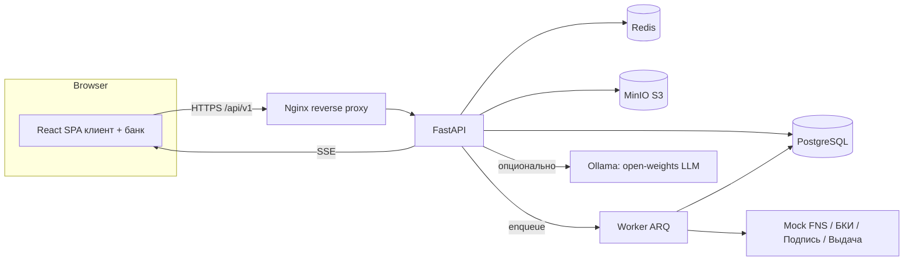
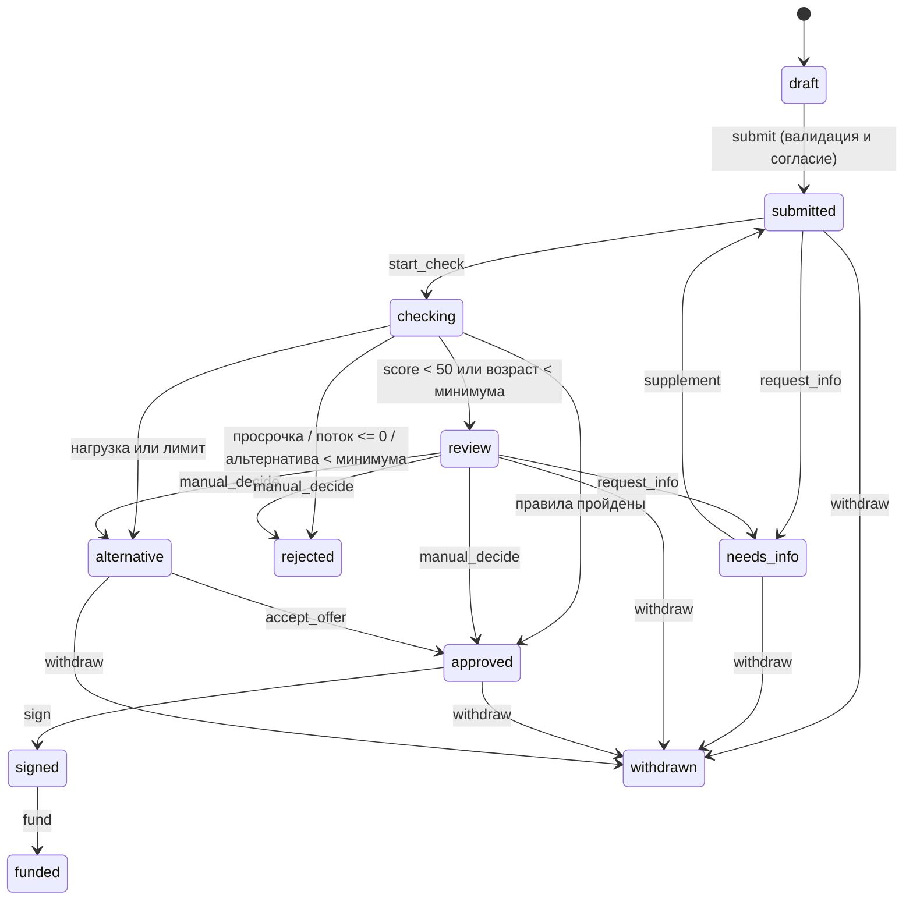

# Умный кредитный кабинет предпринимателя: задача и стек

Источник: `docs/task/Альфа_Хак_Умный_кредитный_кабинет.pdf` (кейс АльфаХак 2026, совместно с АО «Альфа-Банк» и Changellenge).

## 1. Что нужно сделать

Нужен прототип цифрового кредитного конвейера для малого и микробизнеса. Он объединяет клиентский путь и внутреннюю обработку заявки банком в один процесс. Это должен быть работающий прототип, а не набор картинок.

### Сквозной сценарий (минимум)

1. Клиент определяет потребность, выбирает продукт и формирует заявку: сумма, срок, цель, сведения о компании.
2. Заявка становится объектом банковского процесса: приём, проверка полноты и корректности, приведение к единому виду. Если данных не хватает, банк запрашивает уточнение или дополнение.
3. Обогащение данными из внутренних и внешних источников (симуляторы):
   - БКИ (кредитная история);
   - ЕГРЮЛ/ЕГРИП и ФНС «Прозрачный бизнес» (статус, руководители, ОКВЭД, адреса).
4. Скоринг и кредитное решение. Это разные вещи:
   - Скоринг даёт оценку риска. Это может быть простая балльная модель или набор правил.
   - Решение учитывает продукт, сумму, срок, результаты проверок и правила банка.
   - Результат не бинарный: одобрение, отказ, другие условия (сумма, срок, продукт), запрос сведений, ручной анализ.
5. После одобрения идёт оформление: договор, подписание и выдача. Всё это смоделировано, без реальных операций.
6. Клиент видит статус заявки в реальном времени. Банк работает с очередью.

### Обязательные требования

| Область | Требование |
|---|---|
| Клиентская часть | Веб-интерфейс. Мобильное приложение не допускается. |
| Сохранение | Данные сохраняются, состояние заявки меняется последовательно и динамично. |
| Сценарий | Весь путь проходит внутри продукта. Email, мессенджеры, SMS и звонки в нём не участвуют. |
| Автономность | Нет доступа к системам Альфа-Банка. БКИ, ФНС, подпись и выдача делаются моками и симуляторами. |
| Данные | Только синтетические. Нужны тестовые учётные записи для сквозного прохождения. |
| Бесплатность | Нет платных API, подписок и закрытых лицензий. |
| LLM | Только модели с открытыми весами, и только если есть понятная ценность. |
| Запуск | Cloud-native, Docker. Единая команда запуска на обычном ПК. Публикация на бесплатном хостинге желательна. |
| Воспроизводимость | Версии языка и библиотек зафиксированы lock-файлами. |
| Новостная лента | На демо показать, как лента меняется под клиента и что в новостях. Нужен бэкенд персонализации. |

### Что сдавать в репозитории

- GitHub-репозиторий с историей коммитов и commit hash/тегом на дедлайн. Для приватного репозитория нужен доступ аккаунту `alfa-hack-2026`.
- `README.md`: назначение, архитектура, требования, запуск, переменные окружения, компоненты, пошаговая проверка.
- `THIRD_PARTY_NOTICES` со сторонними компонентами и списком смоделированных интеграций.
- Архитектурная схема.
- Описание API, OpenAPI/Swagger, коллекция запросов (`.http`, Postman или Bruno).
- Диаграмма состояний заявки.
- Модель данных (ER).
- Тестовые сценарии.
- Docker-конфигурация (`compose.yaml`, Dockerfile).

### Критерии оценки

1. Целостность связного процесса.
2. Качество UX для клиента и банка.
3. Согласованность модулей (данные сквозные, статусы меняются последовательно).
4. Enterprise-подход: безопасность, надёжность, отказоустойчивость, масштабирование, сопровождение.
5. Потенциал развития (обоснованные решения, известные ограничения).
6. Готовность к проверке (запуск, инструкции, тестовые данные).

## 2. Общая архитектура



- **Frontend:** Vite + React + TypeScript + Tailwind (перенос с `говнокод/`).
- **Backend:** Python, FastAPI, REST `/api/v1`, SSE для статусов в реальном времени.
- **Worker:** фоновые проверки заявки, а именно ФНС, БКИ и скоринг. Обработка идёт асинхронно, клиент видит шаги в реальном времени.
- **Моки внешних систем** живут в том же репозитории, за интерфейсами (порты и адаптеры), и выдают детерминированные синтетические данные по ИНН.

## 3. Стек бэкенда (Python)

### Ядро

| Слой | Выбор | Зачем |
|---|---|---|
| Язык | **Python 3.12** | Фиксируем версию в `.python-version` и в Docker-образе. |
| Менеджер зависимостей | **uv** (`pyproject.toml` + `uv.lock`) | Lock-файл, быстрая сборка, воспроизводимость. |
| Web-фреймворк | **FastAPI** + **Uvicorn** (в проде `gunicorn -k uvicorn.workers.UvicornWorker`) | Асинхронность, автогенерация OpenAPI/Swagger (требование кейса). |
| Валидация и схемы | **Pydantic v2**, `pydantic-settings` | Типизированные DTO и конфиг из окружения (12-factor). |
| ORM | **SQLAlchemy 2.0** (async) + **asyncpg** | Типизированная работа с БД. |
| Миграции | **Alembic** | Версионирование схемы. |
| БД | **PostgreSQL 16** | Транзакции, JSONB (снимки заявки и аудит), индексы под очередь. |
| Кэш, очереди, лимиты | **Redis 7** | Брокер задач, rate limit, ключи идемпотентности, pub/sub для SSE. |
| Фоновые задачи | **ARQ** (async, на Redis) | Легче Celery, нативный `asyncio`. Запасной вариант — Celery. |
| Файлы | **MinIO** (S3-совместимое) через `aioboto3` | Документы вне БД, presigned URL. |
| Реальное время | **SSE** (`sse-starlette`) | Статусы заявок и обращений без WebSocket. Проще проксировать. |

### Безопасность

- **Аутентификация:** JWT access (15 мин) в памяти клиента и refresh в `httpOnly`, `SameSite=Strict` cookie с ротацией. Библиотеки: `pyjwt`, `argon2-cffi`.
- **Пароли:** Argon2id, а не SHA-256 на клиенте, как в прототипе.
- **RBAC:** роли `client`, `bank_analyst`, `bank_admin`. Проверка делается серверно, на уровне dependency FastAPI.
- **Мультитенантность:** клиентский доступ ограничен `organization_id` (проверка членства пользователя в организации).
- **Идемпотентность и конкуренция:** заголовок `Idempotency-Key` (Redis) и optimistic locking по полю `version` у заявки. Конфликт даёт `409`.
- **Аудит:** append-only таблица `application_events` с цепочкой хешей. Каждая запись содержит хеш предыдущей, чтобы подмена обнаруживалась.
- **Rate limiting:** `slowapi` или собственный middleware на Redis (особенно `/auth/*`).
- **Файлы:** проверка MIME и magic bytes (`python-magic`), лимит 10 МБ, антивирус ClamAV опционально (compose-профиль `av`).
- **Прочее:** CORS по белому списку, security-заголовки, секреты только через env, `pip-audit` и `bandit` в CI.

### Скоринг и решение

- Чистый модуль `domain/scoring` без зависимостей от БД и HTTP. Он легко покрывается тестами.
- Балльная модель на правилах (прозрачная, объяснимая):
  - базовый балл 92;
  - штраф за нагрузку: >70% даёт −35, >40% даёт −18, иначе −4;
  - просрочка −40;
  - возраст бизнеса меньше минимума продукта −20;
  - добавляются сигналы БКИ и ФНС (статус компании, просрочки по БКИ, наличие руководителей и ОКВЭД).
- Отдельный `domain/decision` (приоритеты правил): отказ → ручной анализ → другие условия → одобрение.
- Каждое решение хранит `explanation[]`, то есть список сработавших правил. Клиент и банк видят «почему».
- Версионирование набора правил (`rules_version`), записываемое в решение.

### ИИ (по желанию, с реальной ценностью)

- **Ассистент клиента:** вопросы по статусу, документам, платежу. Работает через **Ollama** с open-weights моделью (например Qwen2.5-7B-Instruct или Llama 3.1 8B). Контекст: статус заявки, документы, правила.
- **Grounding:** ответ строится только на данных из БД и правил. Если LLM недоступна, включается сценарный fallback, как в прототипе.
- Эскалация на оператора создаёт обращение в поддержку.
- **Краткая сводка заявки для аналитика** (опционально): та же модель, с пометкой «не заменяет решение».
- Ollama запускается отдельным compose-профилем `llm`. Основной сценарий от неё не зависит.

### Тестирование и качество

| Инструмент | Для чего |
|---|---|
| `pytest`, `pytest-asyncio`, `httpx.AsyncClient` | Unit и API-тесты. |
| `testcontainers` | Реальные Postgres и Redis в интеграционных тестах. |
| `hypothesis` | Property-тесты для аннуитета, графиков, скоринга. |
| `schemathesis` | Проверка API по OpenAPI. |
| `factory-boy` / `faker` (ru_RU) | Синтетические данные. |
| `ruff` (lint + format), `mypy --strict` | Статика. |
| `pre-commit`, GitHub Actions | CI: lint, types, tests, `pip-audit`, сборка образов. |

### Наблюдаемость

- Логи: `structlog` (JSON, с `request_id` и `application_id`).
- Метрики: `prometheus-fastapi-instrumentator`, эндпоинт `/metrics`.
- Трассировка: OpenTelemetry (опционально).
- Healthcheck: `/health/live`, `/health/ready` (проверка Postgres, Redis, MinIO).

### Docker / запуск

`docker compose up --build` поднимает всё. Сервисы:

| Сервис | Образ | Примечание |
|---|---|---|
| `web` | nginx + собранный SPA | Проксирует `/api` на `api`. |
| `api` | python:3.12-slim, multi-stage, non-root | Миграции применяются при старте (`alembic upgrade head`). |
| `worker` | тот же образ, другая команда | Обрабатывает очередь проверок. |
| `postgres` | postgres:16 | Volume и healthcheck. |
| `redis` | redis:7 | |
| `minio` | minio | Бакет создаётся init-скриптом. |
| `ollama` | ollama/ollama | Только профиль `llm`. |
| `clamav` | clamav/clamav | Только профиль `av`. |

Сидинг: команда `python -m app.cli seed` создаёт тестовые аккаунты, организации и демо-заявки. В `.env.example` перечислены все переменные.

### Структура проекта бэкенда

```text
backend/
  pyproject.toml, uv.lock, alembic.ini
  app/
    main.py                # создание FastAPI, роутеры, middleware
    core/                  # config, security, deps, errors, logging
    api/v1/                # роутеры: auth, organizations, products, applications, bank, feed, ...
    domain/                # чистая бизнес-логика
      finance.py           # аннуитет, дифф. платежи, графики, quote
      matching.py          # подбор продуктов
      scoring.py           # скоринг
      decision.py          # решение
      state_machine.py     # переходы заявки
      feed_rules.py        # персонализация ленты
    services/              # прикладные сценарии (use cases)
    repositories/          # доступ к БД
    models/                # SQLAlchemy
    schemas/               # Pydantic DTO
    integrations/          # порты + моки: fns, bki, esign, payout, llm
    workers/               # ARQ-задачи
    cli.py                 # seed, create-operator
  tests/{unit,api,integration,scenarios}
```

### Модель данных (основные таблицы)

| Таблица | Ключевые поля |
|---|---|
| `users` | id, email, name, password_hash, role, created_at |
| `organizations` | id, name, inn, legal_form, profile, region, revenue, expenses, debt, age_months, goal, cash_balance, cash_balance_at |
| `organization_members` | user_id, organization_id, role |
| `finance_months` | organization_id, month, revenue, expenses, debt, source |
| `onboarding_drafts` | user_id, step, data (JSONB) |
| `products` | id, name, kind, scheme, secured, min/max amount, min/max months, rate, daily_rate, min_age, category, features (JSONB), source_url |
| `application_drafts` | organization_id, product_id, data (JSONB), step |
| `applications` | id (`AK-XXXXXXXX`), organization_id, product_id, status, version, amount, months, rate, scheme, days, fee, goal, snapshot (JSONB), assignee_id, offer_amount, original_amount, comment, requested_doc_count, manual_reason, created_at |
| `documents` | id, organization_id, application_id?, name, size, mime, kind (`sample`/`upload`), storage_key, sha256 |
| `application_events` | id, application_id, actor_id, actor_role, type, text, payload, prev_hash, hash, at |
| `risk_assessments` | id, application_id, score, load, cash_flow, result, alt_amount, explanation (JSONB), rules_version, inputs (JSONB) |
| `external_checks` | id, application_id, source (`fns`/`bki`), status, payload (JSONB), at |
| `review_checks` | application_id, key, checked, by, at (чек-лист аналитика) |
| `internal_notes` | id, application_id, author_id, text, at |
| `feed_items` | id, kind, title, body, tags, conditions (JSONB), cta (JSONB) |
| `feed_deliveries` | id, organization_id, item_id, reason (JSONB), dismissed_at |
| `support_tickets` / `support_messages` | id, organization_id, status, author, text, at |
| `notifications` | id, user_id, type, payload, read_at |
| `idempotency_keys` | key, user_id, request_hash, response, expires_at |

ER-диаграмму сгенерировать из моделей (`eralchemy` или Mermaid) и положить в `docs/data-model.md`.

### Диаграмма состояний заявки



Статус `checking` добавлен по сравнению с прототипом. Это промежуточное состояние, пока воркер выполняет проверки ФНС, БКИ и скоринг. Из него клиент видит анимацию шагов.

## 4. Личные замечания к переносу

- В прототипе все данные лежали в `localStorage`, а оператор «читал» localStorage всех клиентов. В новой архитектуре это заменяется серверной БД и ролями.
- Креды оператора `OP-2026 / Alfa2026!` уйдут из кода в сидинг (`.env` и CLI).
- Ключи `localStorage` старого прототипа переносить не нужно. Данные генерируются сидом.
- Расчётная логика (аннуитет, `quoteMath`, `matchProduct`, `risk`) живёт на бэкенде как единый источник правды. Фронтенд может считать превью локально для отзывчивости слайдеров, но итог и решение приходят с сервера.

## 5. План работ

1. Каркас репозитория: `backend/`, `frontend/`, `compose.yaml`, `.env.example`, CI.
2. Бэкенд: модели, миграции, auth, организации, продукты (seed из `products.js`), расчёты.
3. Бэкенд: заявки, state machine, документы, события, SSE.
4. Бэкенд: воркер, моки ФНС и БКИ, скоринг и решение, банковская очередь.
5. Бэкенд: лента, аналитика, ассистент, поддержка, демо-сценарии.
6. Фронтенд: перенос дизайна в React + TS + Tailwind и подключение к API.
7. Документация: OpenAPI, `.http`-коллекция, диаграммы, README, THIRD_PARTY_NOTICES, тест-сценарии.
8. Тесты, демо-данные, прогон полного сценария, публикация.

Список всех эндпоинтов находится в `docs/API.md`.
