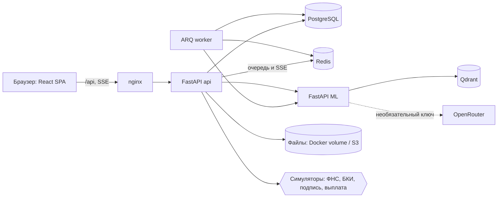
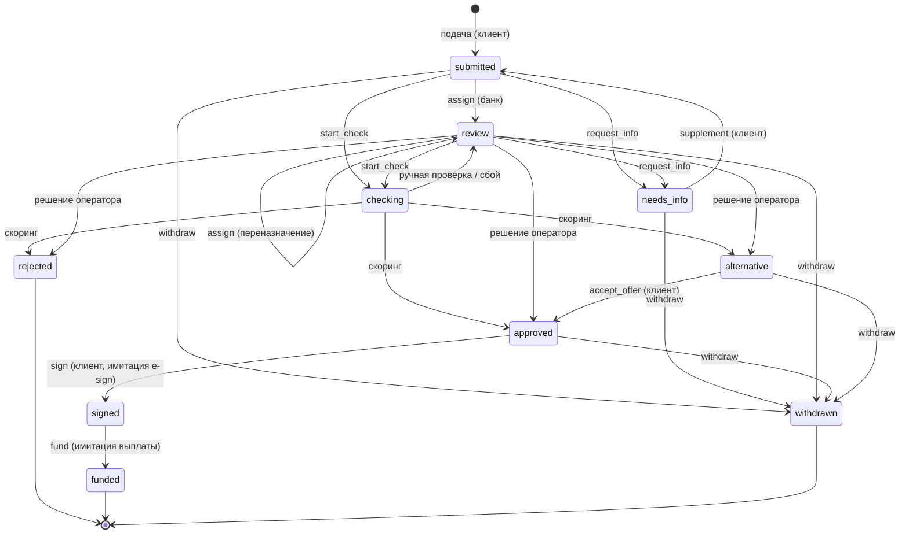

# Архитектура «Альфа Пульс»

## Компоненты

Кабинет клиента и банковская обработка работают в одном API; роли разделены RBAC
(`client`, `bank_analyst`, `bank_admin`). В основном Docker-сценарии заявки обрабатывает ARQ worker,
а браузер получает обновления по SSE. Для локальной разработки без Redis проверка идёт через
`asyncio.create_task`, события SSE хранятся в памяти процесса. ML-сервис не хранит заявки и не
принимает окончательное кредитное решение.

## Диаграмма состояний заявки

Единственный источник переходов — `backend/app/domain/state_machine.py`.

Статус `draft` существует только как черновик (`application_drafts`) до подачи.

## ER-модель

```mermaid
erDiagram
  users ||--o{ refresh_tokens : has
  users ||--o{ organization_members : "член"
  organizations ||--o{ organization_members : has
  organizations ||--o{ finance_months : "история финансов"
  organizations ||--o| application_drafts : "черновик"
  organizations ||--o{ applications : has
  organizations ||--o{ documents : has
  products ||--o{ applications : "по продукту"
  applications ||--o{ application_events : "журнал + hash-chain"
  applications ||--o{ documents : "вложения"
  applications ||--o{ risk_assessments : "скоринг"
  applications ||--o{ external_checks : "ФНС / БКИ"
  applications ||--o{ check_runs : "прогон проверки"
  applications ||--o{ review_checks : "чек-лист оператора"
  users ||--o{ feed_dismissals : "скрытые новости"
  feed_items ||--o{ feed_dismissals : ""
  users ||--o{ assistant_conversations : has
  assistant_conversations ||--o{ assistant_messages : has
  users ||--o{ support_tickets : has
  support_tickets ||--o{ support_messages : has
  users ||--o{ notifications : has
  users ||--o{ idempotency_keys : "ключи идемпотентности"
```

## Скоринг (rule-based, версионируемый)

База 92 баллов. Штрафы: долговая нагрузка (≥0.7 → −35, ≥0.4 → −18, иначе −4), просрочки −40,
возраст бизнеса (в месяцах) меньше минимума продукта −20. Ниже порога 50 или при «молодом» бизнесе — ручная проверка;
при нагрузке выше `alt_load_limit` (0.6) предлагается альтернативная сумма (шаг 10 000 ₽).
Правила хранятся в БД с номером версии; каждая оценка сохраняет версию и входные данные.
Это отдельный версионируемый скоринг и правила решения backend. ML-сервис возвращает оценку риска и факторы;
backend применяет продуктовые ограничения и сохраняет результат решения с версией правил.

## Тестовые сценарии

| Сценарий | ИНН | Ожидаемый результат |
|---|---|---|
| Одобрение | `7701234567` | `approved` |
| Альтернативные условия | `502912345678` (ИП Петров) | `alternative` + сумма предложения |
| Ручная проверка | `7712345678` (возраст 4 мес., просрочка) | `review` → решение оператора |
| Отказ по ФНС | `0012345678` (префикс `00`: ликвидация) | `rejected` |
| Отказ по БКИ | `7723456799` (окончание `99`: просрочка) | `rejected` |
| Запрос документов | любая заявка в `review` | `needs_info` → дополнение → `submitted` |
| Идемпотентность | повтор `POST /applications` с тем же ключом | вторая заявка не создаётся |
| Оптимистичная блокировка | `sign` с устаревшей `version` | 409, `stale_version` |
| Целостность журнала | `GET /bank/audit/verify` | цепочка хэшей валидна |

Автотесты: `cd backend && uv run pytest -q` (домен, API и сквозные сценарии).
