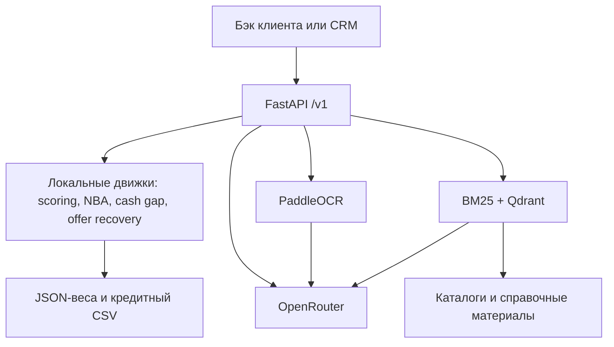

# Архитектура системы

## Область ответственности

Приложение FastAPI в `src/app/main.py` собирает сервисы при старте. Qdrant хранит векторную часть базы знаний; BM25 остаётся в памяти приложения. Движки скоринга, NBA, прогноза и подбора альтернатив вычисляют результат локально. OpenRouter нужен для текстовых функций и окончательного порядка рекомендаций Credit Advisor.

### Кто отвечает за что

| Компонент | Вход | Ответственность |
| --- | --- | --- |
| `app.schemas`, `app.model` | HTTP JSON | Типы, диапазоны и запрет неизвестных полей |
| `ScoringEngine` | Финансовые и продуктовые признаки | Оценка риска и вклады параметров |
| `CreditAdvisor` | Профиль и каталог кредитов | Проверка обязательных правил и локальная оценка кандидатов |
| `Underwriting` | Готовый снимок, скоринг, проверки | Аналитическое резюме; серверные сложность и приоритет |
| `Decision Explainer` | Риски резюме после ручного отказа | Одно сообщение клиенту |
| `CRM Copilot` | Вопрос и снимок CRM | Пробелы в данных, следующие шаги, черновик ответа |
| `Document Parser` | PDF/PNG/JPEG | OCR, извлечение профиля, привязка полей к страницам |
| `Offer Recovery` | Отказы и рекомендованные кредиты | Перебор суммы/срока по тем же весам скоринга |
| `AI Assistant` | Вопрос | Поиск документов и ответ с проверяемым `knowledge_id` |

## Путь заявки

1. Бэк получает сведения о бизнесе. Если клиент загружает документы, парсер возвращает профиль и источники; клиенту показывают на подтверждение только `profile`.
2. Бэк передаёт профиль в скоринг и подбор продуктов. Скоринг не принимает решение. Credit Advisor применяет правила каталога до LLM-ранжирования.
3. Для анализа бэк отправляет Underwriting готовый снимок со скорингом и результатами проверок. Сервис не вызывает ScoringEngine повторно.
4. Сотрудник видит резюме в CRM и сам выбирает решение. При выборе отказа CRM может вызвать Decision Explainer. Для вопросов клиента CRM Copilot возвращает черновик и данные, которых не хватает.
5. После отказа Offer Recovery может пересчитать допустимые сумму и срок для ранее рекомендованных кредитных продуктов. Результат остаётся оценкой риска демонстрационной модели.

## Границы доверия

- **Контракт бэка:** Pydantic отклоняет лишние ключи и неверные диапазоны. Проверка идентификаторов и связности вложенных объектов выполняется в конкретных схемах.
- **Вывод LLM:** даже при JSON Schema сервер повторно проверяет структуру, ссылки на факты, допустимые ID продуктов и наличие цитат. Текст LLM остаётся черновиком для сотрудника.
- **OCR:** файл проверяется по размеру и сигнатуре; ссылка LLM на страницу и цитату должна совпасть с распознанным текстом. Это не проверка подлинности документа.
- **Внешние системы:** ФНС, БКИ и банковский бэк не вызываются. В тестах они представлены синтетическими входными данными; OpenRouter является отдельным внешним провайдером текста.
- **Хранение:** API не сохраняет заявки и файлы. Qdrant хранит справочные знания, а временные файлы OCR удаляются после распознавания.

## Запуск и воспроизводимость

`docker compose up --build` запускает `qdrant` и `app`; приложение ждёт готовности Qdrant, загружает веса, строит индекс знаний и только затем отвечает на `/health`. Сборка образа заранее скачивает модели PaddleOCR и энкодера. Для локальных расчётов ключ OpenRouter не требуется; LLM-маршруты без него возвращают `503`.

Версии Python и библиотек фиксирует `pyproject.toml` вместе с `uv.lock`. Пороги и лимиты находятся в конфигурациях сервисов; каталоги `data/*.csv` служат входом для продуктовых правил и знаний ассистента. Состав HTTP-контрактов: [Взаимодействие с API](<Взаимодействие с АПИ.md>).
