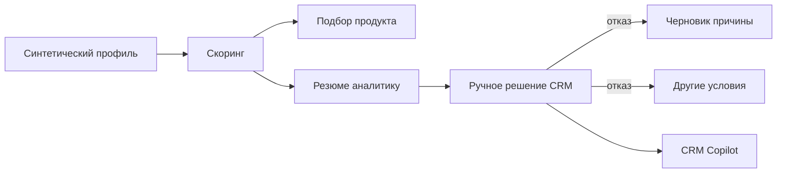

# Границы MVP

## Цель демонстрации

Показать отдельные проверяемые шаги кредитного пути малого и микробизнеса: получить структурированный профиль, оценить риск, подобрать допустимые продукты, помочь аналитику прочитать заявку и подготовить коммуникацию после ручного решения. Это **API-прототип**, а не действующий банковский конвейер.

## Роли и сценарии

| Роль | Что может получить через API | Что остаётся вне репозитория |
| --- | --- | --- |
| Предприниматель через бэк | Предложение заполнить профиль из документов; скоринг, продуктовые и некредитные рекомендации, прогноз, справочный ответ | Личный кабинет, авторизация, подтверждение полей, отправка заявки |
| Кредитный аналитик через CRM | Резюме заявки с рисками, недостающими данными, сложностью и приоритетом | CRM-экран, принятие и запись кредитного решения |
| Сотрудник поддержки через CRM | Причину уже выбранного отказа, пробелы для ответа, следующие действия и черновик | Отправка клиенту, контроль SLA, журнал коммуникаций |
| Бэк банка | JSON-контракты для обмена синтетическими снимками | Реальные ФНС, БКИ, банковские счета, хранение заявок |

## Основной путь

При загрузке документов клиенту предлагают подтвердить `profile`; `additional_facts` хранятся только как отдельный результат извлечения. Скоринг возвращает риск, а не решение. Credit Advisor фильтрует по правилам до LLM-ранжирования. Underwriting использует уже готовый скоринг. Decision Explainer запускается только после ручного отказа. Offer Recovery пересчитывает варианты в памяти и не обещает одобрения.

## Проверяемые результаты MVP

- 11 прикладных HTTP-маршрутов и `/health` со схемой OpenAPI.
- Локальный скоринг, NBA, прогноз кассового разрыва и подбор альтернатив по весам модели.
- OCR документов с фиксированным профилем, источниками каждого заполненного поля и отдельными дополнительными фактами.
- Текстовые сценарии через OpenRouter с проверкой JSON, допустимых ID и ссылок на данные.
- Гибридный поиск Qdrant/BM25 с идентификаторами знаний и датой среза.
- Синтетический интеграционный сценарий всех маршрутов в `tests/test_api.py`.

## Допущения и ограничения

1. Все входы и примеры демонстрационные. Реальные персональные, банковские и кредитные данные не должны попадать в репозиторий или OpenRouter.
2. Веса, пороги, продуктовые диапазоны и справочные каталоги нужны для демонстрации. Публичные тарифы и правила доступности меняются; здесь нет актуальной индивидуальной оферты.
3. Оценка `1 - risk_probability`, используемая при предварительном ранжировании кредита, не калибрована как вероятность банковского одобрения. Кредитное решение не реализовано.
4. В проекте нет состояния заявки, авторизации, аудита действий, хранения документов, решения банка, фронтенда и реальных интеграций ФНС/БКИ.
5. Проверка формата и происхождения ссылок LLM не гарантирует смысловую точность. Текст для клиента подтверждает сотрудник.
6. Локальные тесты с подменной LLM подтверждают контракт. Для живой генерации нужен ключ OpenRouter и отдельная проверка качества ответов.

## Что нужно до реальной эксплуатации

Потребуются банковский Decision Service и утверждённые правила, согласование обработки данных внешним провайдером, авторизация, безопасное хранение и аудит, актуализация каталога продуктов, проверка/калибровка моделей на допустимых данных и отдельные процедуры контроля объяснений. Эти части не заявлены реализованными.

[Архитектура](../architecture/Обзор-системы.md) · [HTTP API](<../architecture/Взаимодействие с АПИ.md>)
